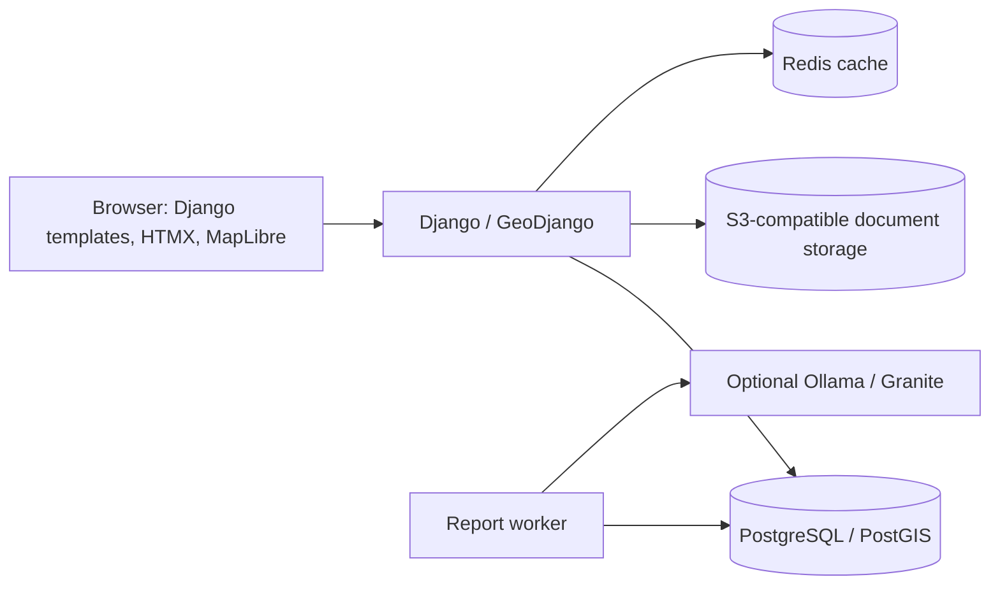

# MINDS Geospatial

An exploration and mining knowledge system that connects geological records, technical documents, spatial investigation and traceable reporting.

MINDS brings the evidence behind an exploration decision into one workflow: manage project data, investigate a prospect, inspect supporting records, prepare a report and review a fixed revision. Reports can combine authored narrative, optional evidence-scoped AI drafting, geological tables and a collar-location figure.

**Status:** active development. The current application has been verified with 600 automated tests and targeted browser/file-format checks. A supported local profile and CI workflow cover setup, migrations, lint, tests and synthetic HTTP/worker checks. Broader interface work and production deployment remain in progress. There is no public demo release yet.

[Architecture](docs/ARCHITECTURE.md) · [Development setup](docs/DEVELOPMENT.md) · [Verification](docs/VERIFICATION.md) · [Roadmap](docs/ROADMAP.md)

## The workflow

1. **Organise evidence.** Maintain projects, prospects, documents and drillhole records within an organisation.
2. **Import and inspect.** Validate collar, survey, lithology and assay workbooks before writing; inspect locations and linked records on the map.
3. **Develop a prospect.** Connect an interpretation and investigation objective to its documents and drillholes.
4. **Prepare a report.** Start with a manual outline or request an AI-assisted draft from a bounded set of accessible evidence.
5. **Assemble geological evidence.** Capture collar, Au/Cu assay and lithology tables, with an optional collar-location figure.
6. **Review and export.** Save revisions, submit a fixed version for review and export its narrative and geological appendix to PDF or DOCX.

## Capabilities

| Area | Current implementation |
|---|---|
| Documents | PDF/DOCX text extraction, organisation-scoped access, checksums, version chains and private downloads |
| Geological data | Collar, survey, lithology and assay records; validated workbook imports with dry runs and atomic replacement |
| Geography | PostGIS geometry and MapLibre views for projects, tenements, prospects and drillholes |
| Search and drafting | PostgreSQL full-text retrieval, ranked document passages, explicit evidence selection and inspectable drafting inputs |
| Background work | Durable PostgreSQL report queue, progress stages, explicit retry, cancellation, interrupted-worker recovery and submission receipts |
| Report assembly | Manual outlines, editable narrative and versioned geological tables/figures captured from the selected project or prospect |
| Governance | Organisation/role/clearance checks, report revisions, review transitions and audit records |
| Export | Native DOCX tables and embedded figure; PDF tables and vector figure using the saved geological snapshot |
| Evaluation | Versioned synthetic retrieval/citation cases and an offline regression command |

JORC/VALMIN-labelled review routes support human review. They do not establish certification or regulatory compliance. Citation feedback checks labels and literal excerpt matches; it does not prove factual or semantic support.

## Architecture



PostgreSQL owns report-job claims and publication state. Model calls run outside database transactions. The worker checks source snapshots and current access before publishing a draft. Cancellation invalidates the attempt token so late responses cannot save a cancelled draft.

Manual drafting uses the same worker without a model call. Saved geological appendices retain their own values, record IDs, scope, capture time and digest. Later edits to live geological data do not silently alter a saved report.

## Technology

| Layer | Stack |
|---|---|
| Application | Python 3.11, Django 5.2, GeoDjango |
| Database | PostgreSQL 16, PostGIS 3.4 |
| Interface | Django templates, HTMX, Tailwind CSS, MapLibre GL JS, EasyMDE |
| Storage and cache | MinIO-compatible S3 storage, Redis |
| Drafting | IBM Granite through Ollama; optional Hugging Face adapter |
| Reports | ReportLab, python-docx, Pillow |
| Development | Docker Compose, Django test runner, Ruff |
| Optional telemetry | OpenTelemetry, Grafana, Prometheus, Loki, Tempo, Alloy |

Application and development dependencies are defined in [pyproject.toml](pyproject.toml), resolved in [uv.lock](uv.lock), and installed with a frozen lock. The hash-pinned [runtime requirements](infra/web/requirements.txt) are generated from that lock. Image digests and the Python version are pinned for the supported profile.

## Local development

Use Docker Engine/Desktop with Compose v2.24 or newer. Linux/amd64 is the verified platform. Manual reports need no model or object-store service.

```bash
git clone https://github.com/IvanVanRooyen/IFB398-T07-MINDS-.git
cd IFB398-T07-MINDS-
cp .env.example .env
```

Replace the secret/password placeholders, including `DEMO_PASSWORD` (at least twelve characters). Then:

```bash
docker compose -f compose.dev.yml config --quiet
docker compose -f compose.dev.yml up --build -d
docker compose -f compose.dev.yml exec web python manage.py seed_demo
```

Open **http://localhost:8000**. Log in as `demo-geologist` or `demo-reviewer` using the configured demo password. The seed supplies a clearly synthetic exploration project, linked evidence, drillholes/intervals, a real DOCX and a report with geological tables/figure. Neither account is a platform administrator. Repeat seeding preserves edits and passwords; `seed_demo --reset` replaces only the synthetic project and its records.

The supported local profile runs PostgreSQL/PostGIS, Redis, the web app and a separate worker, with private filesystem-backed documents. Only the loopback web endpoint is published. A one-shot migration service gates application startup. Application code is built into the image, with no personal directories or source mounts required.

AI-assisted drafting is optional and requires an explicitly configured provider/model. The default is `granite3.2:8b-instruct-fp16` through Ollama; the application does not download weights. Platform administration can be configured separately with `createsuperuser`.

[Development details](docs/DEVELOPMENT.md) cover environment validation, seeding/reset, dependencies and optional services. The legacy S3/telemetry Compose definition remains separate and is not a verified production deployment.

## Verification and CI

```bash
docker compose -f compose.dev.yml --profile test run --rm checks
docker compose -f compose.dev.yml --profile test run --rm checks sh scripts/audit.sh
docker compose -f compose.dev.yml exec -T web python -m scripts.smoke
```

The checked-in [CI workflow](.github/workflows/ci.yml) runs on pushes and pull requests. It builds locked dependencies, checks lock/export consistency and whole-repository lint, applies migrations, checks schema drift, runs the PostGIS suite and offline evaluation, audits runtime dependencies, then checks the synthetic HTTP/worker workflow. The same commands run locally. Hosted execution begins when the workflow is pushed; no GitHub success badge is claimed from local verification.

The last verified suite, on 19 November 2026, passed **600 tests**, including real transaction/concurrency and seed/reset regressions. HTTP checks verify private document bytes, authenticated routes and manual drafting completed by a separate worker. Test settings use isolated files/cache and prevent real model access.

The authored passage benchmark selects the annotated answer span in **8/10** answerable cases, compared with **2/10** for leading excerpts. Fourteen citation regression cases pass. These are synthetic development results, not independent benchmarks or measurements of real-model factual accuracy. [Evaluation scope and known misses](docs/ai/QUALITY.md).

[Verification details](docs/VERIFICATION.md) distinguish automated coverage, browser checks and unverified deployment/model behavior.

## Repository structure

```text
config/                 Django configuration and platform administration
core/
  access.py             Shared organisation, role and clearance policy
  ai/                   Composition, jobs, retrieval, citations and evaluation
  reporting/            Geological snapshots, figures and export renderers
  importers.py          Workbook validation and import transactions
  management/commands/  Worker, evaluation, import and fixture commands
  migrations/           Database schema history
  tests/                Unit, integration, concurrency and file-format tests
templates/              Application interface
infra/                  Application container and optional telemetry
fixtures/               Original seed data and example documents
docs/                   Architecture, behavior, verification and roadmap
```

## Current limits and next work

The next milestone is the end-to-end UX pass: project → map → prospect → evidence → report, with responsive navigation, static assets and accessible error/empty states.

Further work includes metre-correct spatial queries and stronger relationship validation, real-model/domain evaluation, richer report sections and filters, a meaningful mining-mode example, immutable export packages and a controlled demonstration environment. Geological appendices currently use fixed schemas and bounded record counts; the collar figure is a local schematic, not a survey plan.

See the [roadmap](docs/ROADMAP.md) for the sequence and acceptance conditions.

## Project background

This repository began as the Team T07 university capstone application developed for OreFox. The current rework builds on that shared codebase and retains its document, geospatial, reporting and governance purpose. The independent revisions strengthen data integrity, access policy, evidence handling and report reliability. Original team work and subsequent revisions remain distinguishable through repository history; no claim is made that the original application was a solo project.

## License

The repository does not currently declare an open-source license. No redistribution or relicensing rights are implied by this README.
